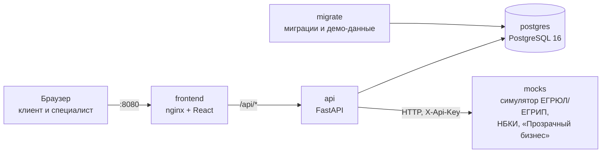
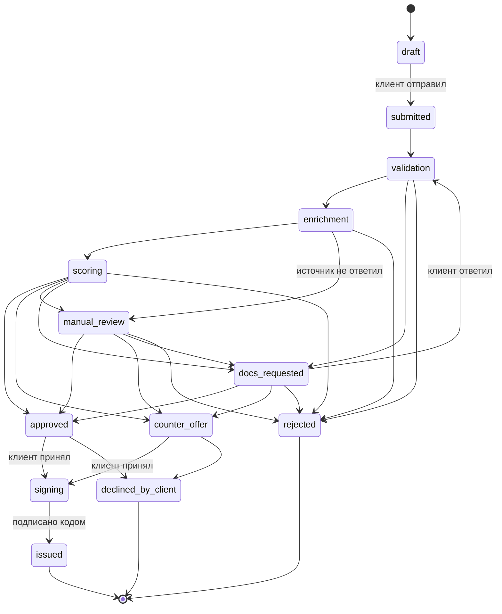

# smart-credit-lk — Умный кредитный кабинет предпринимателя

Цифровой кредитный конвейер для малого и микробизнеса: от возникновения потребности в финансировании
до решения по заявке и выдачи кредита — в едином управляемом процессе. Кейс Альфа-Банка, хакатон «Альфа-будущее».

> **Статус: MVP, этап 3.** Работают кабинет клиента и кабинет кредитного специалиста, хранение в PostgreSQL,
> запросы во внешние источники через симулятор, решение специалиста, подписание и моделируемая выдача.
> Автоматический конвейер (проверка → запрос данных → скоринг → решение без участия специалиста) — этап 4:
> сейчас новая заявка после отправки остаётся в статусе «Заявка подана». Весь путь до выдачи показывается
> на демо-заявках, которые уже находятся на разных этапах (см. [сценарий проверки](#пошаговый-сценарий-проверки)).

## Назначение

**Клиент — действующий клиент банка** (ИП или ООО) — входит в кабинет и:
- подбирает продукт: помощник задаёт 4 вопроса и объясняет, почему продукт подходит; есть каталог из 3 продуктов;
- подаёт заявку в 4 шага: реквизиты подставляются из профиля (вводить ИНН не нужно), контакты, условия, согласия;
  черновик сохраняется на сервере после каждого шага;
- видит статус заявки на таймлайне и результаты проверок банка; страница обновляется сама;
- отвечает на запрос дополнительной информации;
- получает решение с объяснением: какие факторы повлияли и как улучшить условия;
- принимает или отклоняет предложение (в том числе контрпредложение со сравнением с заявкой),
  подписывает договор кодом подтверждения и видит факт выдачи.

**Кредитный специалист банка**:
- работает с очередью заявок: фильтры по статусам, сводка по очереди;
- видит карточку заявки: реквизиты компании, проверки по источникам с подробными данными, входные данные скоринга,
  оценку и рекомендацию системы, историю;
- повторно запрашивает данные из ЕГРЮЛ/ЕГРИП, НБКИ и ФНС «Прозрачный бизнес»;
- принимает решение: одобрить, контрпредложение, запросить информацию, отказать (причина — из справочника).
  Клиент видит решение сразу.

**Прозрачность решения.** ИИ и ML в проекте не используются: подбор продукта, оценка заявки, рекомендация и объяснение
строятся по явным правилам, а у каждого решения есть список факторов. Окончательное решение по спорным заявкам
принимает специалист.

## Архитектура



| Сервис | Что делает | Порт на хосте |
|---|---|---|
| `frontend` | nginx раздаёт сборку React и проксирует `/api/` на `api` | `8080` |
| `api` | REST API кабинета: авторизация, заявки, автомат статусов, проверки, решения, подписание | `8000` |
| `postgres` | хранение заявок, истории, проверок, справочников | `127.0.0.1:5432` |
| `mocks` | симулятор внешних источников со своими форматами, ключом доступа, задержками и сбоями | `127.0.0.1:8001` |
| `migrate` | разовая задача: миграции схемы, справочники и демо-заявки; завершается с кодом 0 | — |

Порядок старта: `postgres` (healthy) → `migrate` (завершился) → `api` (healthy) → `frontend`.
Порты базы и симулятора открыты только для этого компьютера.

**Статусы заявки.** Статус меняется только через автомат статусов бэкенда (`backend/app/services/state_machine.py`),
каждый переход пишется в историю заявки.



Подписи статусов в интерфейсе: черновик, заявка подана, проверяем анкету, запрашиваем сведения, оцениваем заявку,
на проверке у специалиста, нужна информация, одобрено, контрпредложение, отказ, подписание договора, кредит выдан,
клиент отказался.

## Требования к окружению

**Для запуска** нужен только Docker:
- Docker Desktop (Windows, macOS) или Docker Engine (Linux) с Docker Compose v2 (`docker compose version`).
  На Windows Docker Desktop работает поверх WSL 2.
- Свободные порты `8080`, `8000`, `5432`, `8001`; меняются переменными окружения (см. ниже).
- Доступ в интернет при первой сборке — для образов и зависимостей.

**Для разработки без Docker** (необязательно): Node.js 24 и npm — фронтенд; Python 3.12 и [uv](https://docs.astral.sh/uv/) —
бэкенд и симулятор. Подробности — в README каждого компонента.

## Быстрый запуск

Из корня репозитория:

```bash
docker compose up --build -d
```

Первая сборка занимает несколько минут. Проверить, что всё поднялось:

```bash
docker compose ps -a
```

`postgres`, `mocks`, `api`, `frontend` — `healthy`; `migrate` — `Exited (0)`, это норма.

| Что | Адрес |
|---|---|
| **Кабинет** (клиент и специалист) | http://localhost:8080 |
| Swagger API | http://localhost:8000/api/docs |
| Swagger симулятора источников (ключ `local-mocks-key`, кнопка *Authorize*) | http://localhost:8001/docs |

Остановить — `docker compose stop`. Данные хранятся в PostgreSQL и переживают перезапуск.

| Что нужно | Как |
|---|---|
| Вернуть демо-заявки в исходное состояние | кнопка «Сбросить демо-данные» в очереди специалиста или `POST /api/demo/reset` |
| Пересоздать базу полностью | `docker compose down -v && docker compose up --build -d` (удаляет том с данными) |
| Обновить после `git pull` | `docker compose up --build -d` |

## Конфигурация и переменные окружения

Файл `.env` для запуска **не нужен**: у всех переменных есть значения по умолчанию в `docker-compose.yml`.
Чтобы переопределить: `cp .env.example .env` и отредактировать. Настоящий `.env` в репозиторий не коммитится.

| Переменная | По умолчанию | Назначение |
|---|---|---|
| `DEMO_MODE` | `true` | список тестовых учётных записей на экране входа и сброс демо-данных |
| `DEMO_SHOW_SIGN_CODE` | `true` | код подписи договора показывается на экране (вместо SMS) |
| `JWT_SECRET` | dev-значение | секрет подписи токенов, не короче 32 символов; на сервере — обязательно свой |
| `JWT_TTL_MINUTES` | `480` | время жизни сессии |
| `POSTGRES_DB`, `POSTGRES_USER`, `POSTGRES_PASSWORD` | `credit` | база данных |
| `MOCKS_API_KEY` | `local-mocks-key` | ключ доступа к симулятору источников |
| `MOCK_LATENCY_MIN_MS`, `MOCK_LATENCY_MAX_MS` | `300`, `1200` | задержка ответа источников, мс |
| `MOCK_FAILURE_RATE` | `0` | доля случайных сбоев источников (0…1) |
| `INTEGRATION_TIMEOUT_SECONDS`, `INTEGRATION_RETRIES` | `3`, `2` | сколько бэкенд ждёт источник и сколько раз повторяет запрос |
| `WEB_PORT` | `8080` | порт кабинета |
| `API_PORT` | `8000` | порт API |
| `POSTGRES_PORT`, `MOCKS_PORT` | `5432`, `8001` | порты базы и симулятора (только `127.0.0.1`) |

Полный список с пояснениями — [.env.example](.env.example).

## Компоненты

| Папка | Что внутри | Стек | Документация |
|---|---|---|---|
| `frontend/` | кабинет клиента и кабинет специалиста | React 19, Vite 8, React Router 7; без UI-библиотек; nginx в Docker | [frontend/README.md](frontend/README.md) |
| `backend/` | REST API, автомат статусов, проверки по источникам, решения, подписание и выдача | Python 3.12, FastAPI, SQLAlchemy 2, Alembic, PostgreSQL 16, JWT | [backend/README.md](backend/README.md) |
| `mocks/` | симулятор ЕГРЮЛ/ЕГРИП, НБКИ, ФНС «Прозрачный бизнес»: свои форматы, ключ, задержки, сбои | Python 3.12, FastAPI | [mocks/README.md](mocks/README.md) |
| `data/seed/` | справочники, продукты, компании, учётные записи, демо-заявки | JSON | — |
| `docs/` | спецификации OpenAPI, описание фронтенда для бэкенда | — | см. [Документация](#документация) |

**Внешние источники** вызываются как настоящие сетевые сервисы: адаптер на каждый источник, таймаут, повторы
с паузой, параллельный опрос. Если источник не ответил, проверка получает статус «источник временно недоступен»,
а остальные данные сохраняются. Переход на настоящие сервисы — смена адресов `EGR_BASE_URL`, `NBKI_BASE_URL`,
`PB_BASE_URL` и ключа. Реальные сервисы не вызываются.

**Ставки.** Ставка = ключевая ставка ЦБ + надбавка продукта + надбавка за риск. Ключевая ставка — **14%**
(допущение на октябрь 2026, `backend/app/services/finance.py`). Надбавка продукта: оборотный кредит +4,5 п. п.,
кредит на развитие +3,9 п. п., овердрафт +5,5 п. п. Платёж — аннуитетный.

**Подписание и выдача смоделированы**: договор подписывается простой электронной подписью — кодом подтверждения
(в демо-режиме код показан на экране, SMS не отправляется), после подписи кредит считается зачисленным на расчётный
счёт компании. Реальных проводок нет.

## Тестовые учётные записи и данные

Регистрации нет: клиенты — действующие клиенты банка. На экране входа http://localhost:8080/login достаточно выбрать
учётную запись. Все компании, лица и заявки синтетические.

| Учётная запись | Кто | Заявки в демо-данных |
|---|---|---|
| `prodmarket` | ООО «Продмаркет», ИНН 1655482318 | A-1020 — черновик; A-1024 — **контрпредложение**: 1 500 000 ₽ вместо 2 000 000 ₽ |
| `vektor` | ООО «Вектор Софт», ИНН 7810624578 | A-1022 — **одобрено**; A-1026 — запрашиваем сведения |
| `sidorov` | ИП Сидоров П. А., ИНН 504718329642 | A-1023 — **банк запросил информацию** |
| `sibtorg` | ООО «СибТоргКомплект», ИНН 5406247181 | A-1025 — **на проверке у специалиста**: массовый адрес (54 компании) |
| `uralstroy` | ООО «Уралстройинвест», ИНН 6671034827 | A-1021 — **отказ**: компания ликвидирована |
| `analyst` | Смирнова Елена, кредитный специалист | очередь всех заявок, кроме черновиков |

Каждая вкладка браузера держит свою сессию: клиента и специалиста удобно открыть рядом в двух вкладках.
Новые заявки получают номера A-1027, A-1028…

Продукты: оборотный кредит (300 тыс. – 10 млн ₽, до 36 мес.), кредит на развитие (1–30 млн ₽, до 60 мес.),
овердрафт (100 тыс. – 5 млн ₽, до 12 мес.).

## Пошаговый сценарий проверки

Перед началом: `docker compose up --build -d`, открыть http://localhost:8080. Если данные уже менялись —
«Сбросить демо-данные» в очереди специалиста.

**1. Подбор и подача заявки** — `prodmarket`
1. «Подбор кредита»: ответить на 4 вопроса — помощник покажет подходящие продукты и объяснит выбор.
2. «Новая заявка»: реквизиты компании уже заполнены → контакты → условия (продукт, сумма, срок, цель, залог) →
   согласия → «Отправить заявку». Заявка получит номер A-1027 и статус «Заявка подана».
3. «Мои заявки»: черновик A-1020 — «Продолжить»; изменения сохраняются на сервере после каждого шага.

**2. Решение, предложение, подписание, выдача** — `prodmarket`, заявка A-1024
1. «Мои заявки» → A-1024: таймлайн этапов, проверки банка, решение «Одобрено 1 500 000 ₽ вместо 2 000 000 ₽».
2. «Почему такое решение»: факторы решения, объяснение простыми словами, как улучшить условия.
3. «Предложение банка»: сравнение с заявкой, ставка с разбивкой → «Принять предложение».
4. Отметить «Ознакомился с условиями» → «Получить код» → ввести неверный код (появится «Осталось попыток: 2») →
   ввести код с экрана → статус «Кредит выдан», на странице заявки — номер договора и счёт зачисления.

**3. Запрос информации** — `sidorov`, заявка A-1023
1. На странице заявки — что запросил банк и комментарий специалиста. Заполнить поля → «Отправить ответ».
2. Статус меняется на «Проверяем анкету».

**4. Работа специалиста** — `analyst`
1. Очередь заявок: сводка, фильтры по статусам.
2. A-1025: проверки по источникам — «Прозрачный бизнес» с замечанием (массовый адрес), рекомендация системы,
   входные данные скоринга. «Обновить данные из источников» — данные запрашиваются в симуляторе заново,
   в «Подробнее» появляются сведения источников, в истории — отметка о повторном запросе.
3. Решение: «Отказать» без причины — форма подсветит поле причины; выбрать причину, написать комментарий
   для клиента → статус «Отказ». Клиент `sibtorg` увидит решение на странице заявки.
4. A-1022 (одобрено): кнопки повторного запроса данных нет — в этом статусе он не нужен.

**5. Сбой внешнего источника** — `analyst`, заявка A-1025 (до решения по ней или после сброса демо-данных)
1. Swagger симулятора http://localhost:8001/docs → *Authorize* `local-mocks-key` →
   `PUT /admin/sources/nbki` с телом `{"mode": "error"}`.
2. В карточке A-1025 «Обновить данные из источников» → НБКИ: «Источник временно недоступен», причина
   «Сбой на стороне источника»; остальные источники обновились, интерфейс работает.
3. `POST /admin/reset` — вернуть симулятор в норму.

**6. Отказ с объяснением** — `uralstroy`, заявка A-1021: «Почему такое решение» — причина отказа
(по данным ЕГРЮЛ компания ликвидирована), фактор решения и объяснение простыми словами.

## Тесты

```bash
docker compose up -d postgres
(cd backend && uv run pytest)   # API, автомат статусов, база, интеграции, OpenAPI
(cd mocks && uv run pytest)     # симулятор источников
```

Тесты бэкенда используют отдельную базу `credit_test` и не трогают рабочие данные. Подробнее — [backend/README.md](backend/README.md).

## Документация

| Что | Где |
|---|---|
| OpenAPI кабинета (проверяется тестом на совпадение с кодом) | [docs/api/openapi.json](docs/api/openapi.json), Swagger — http://localhost:8000/api/docs |
| OpenAPI симулятора источников | [docs/api/mocks-openapi.json](docs/api/mocks-openapi.json) |
| Бэкенд: запуск, база, источники, история заявки | [backend/README.md](backend/README.md) |
| Симулятор: данные, сбои и задержки | [mocks/README.md](mocks/README.md) |
| Фронтенд: запуск, устройство | [frontend/README.md](frontend/README.md) |
| Как фронтенд использует API | [docs/frontend-for-backend.md](docs/frontend-for-backend.md) |
| Сторонние компоненты и лицензии | [THIRD_PARTY_NOTICES.md](THIRD_PARTY_NOTICES.md) |

## Команда

| Участник | Роль |
|---|---|
| Никита | Backend, скоринг, DevOps |
| Федя | Frontend, UI/UX-дизайн |
| Денис | Продукт, UX/бизнес-анализ, QA, документация |

## Правила совместной работы

Ветки, коммиты, Pull Request и синхронизация с `main` описаны в [CONTRIBUTING.md](CONTRIBUTING.md).
