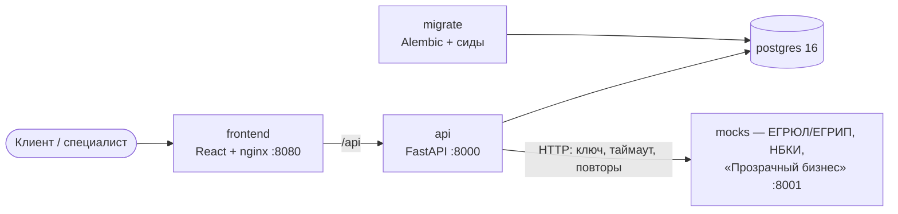

# smart-credit-lk — Умный кредитный кабинет предпринимателя

Цифровой кредитный конвейер для малого и микробизнеса (кейс Альфа-Банка, хакатон «Альфа-Будущее»):
от потребности в финансировании до получения кредита — в едином процессе, где клиент и банк работают
с одной заявкой, данные не вводятся повторно, а статус и следующий шаг всегда видны.

> **Версия для проверки:** тег `v1.0.0` (коммит указан в форме сдачи).
> Что готово и что запланировано — разделы [«Что реализовано»](#что-реализовано) и [«Что предстоит»](#что-предстоит-реализовать).

## Содержание

- [Назначение](#назначение)
- [Что реализовано](#что-реализовано)
- [Архитектура](#архитектура)
- [Требования к окружению](#требования-к-окружению)
- [Быстрый запуск](#быстрый-запуск)
- [Тестовые учётные записи и данные](#тестовые-учётные-записи-и-данные)
- [Пошаговый сценарий проверки](#пошаговый-сценарий-проверки)
- [Конфигурация и переменные окружения](#конфигурация-и-переменные-окружения)
- [Развёртывание на сервере](#развёртывание-на-сервере)
- [Разработка и тесты](#разработка-и-тесты)
- [Допущения и ограничения](#допущения-и-ограничения)
- [Что предстоит реализовать](#что-предстоит-реализовать)
- [Документация](#документация)
- [Команда](#команда)

## Назначение

| Кому | Проблема | Что даёт решение |
|---|---|---|
| Предприниматель | непонятно, какой продукт подходит; нет финансовой экспертизы | помощник подбора по цели, сумме и сроку; объяснение решения простыми словами и с цифрами; подсказки, что улучшить |
| Предприниматель | повторный ввод данных о компании | банк уже знает клиента: реквизиты подставляются, черновик сохраняется на сервере |
| Предприниматель | непрозрачный статус заявки | история заявки по этапам, текущий статус и следующий шаг в кабинете; решение, оффер, подписание и выдача — там же |
| Банк | много заявок с разными параметрами и рисками | единая модель заявки и автомат статусов; данные из внешних источников подтягиваются автоматически; спорные случаи — специалисту, с рекомендацией системы |
| Банк | данные из разных источников, отказы внешних систем | интеграции с таймаутами и повторами; недоступный источник не останавливает работу, а отмечается в проверках |

Процесс по постановке кейса: потребность → подбор продукта → заявка → проверка полноты → обогащение данными
(БКИ, ЕГРЮЛ/ЕГРИП, «Прозрачный бизнес») → оценка риска → решение (одобрение, контрпредложение, запрос информации,
отказ) → подписание → выдача.

## Что реализовано

**Кабинет клиента** (веб-интерфейс, `frontend/`):
- вход по тестовой учётной записи (клиент уже обслуживается в банке — регистрации нет);
- помощник подбора продукта (4 вопроса → рекомендации с пояснениями) и каталог;
- мастер заявки: реквизиты компании подставлены банком, контакты, условия с расчётом платежа, согласия;
- страница заявки: статус, история этапов, проверки, решение и объяснение «почему такое решение»;
- предложение банка (в том числе контрпредложение с разницей «просили — предлагаем»), принятие или отказ;
- подписание договора одноразовым кодом и выдача;
- ответ на запрос дополнительной информации.

**Кабинет специалиста банка:**
- очередь заявок с фильтром по статусу;
- карточка заявки: оценка, факторы с баллами, входные данные, проверки по источникам с данными, рекомендация системы;
- повторный запрос данных из внешних источников;
- решение: одобрить, контрпредложение, запросить информацию, отказать (причина из справочника).

**Бэкенд** (`backend/`, FastAPI + PostgreSQL):
- API кабинета (24 эндпоинта), единый формат ошибок, OpenAPI;
- JWT и роли; клиент видит только свои заявки и клиентскую проекцию без внутренних оценок банка;
- автомат статусов заявки (13 статусов) — единственное место смены статуса, каждое изменение — в истории;
- хранение в PostgreSQL, миграции Alembic, справочники и демо-данные из JSON, сброс демо-данных;
- подача заявки с согласиями и защитой от повторной отправки (`Idempotency-Key`);
- оптимистичная блокировка: одновременные изменения заявки не затирают друг друга;
- предложение банка со ставкой (ключевая + спред продукта + надбавка за риск) и аннуитетным платежом;
- подписание: код хранится только в виде хеша, 5 минут, 3 попытки; договор и выдача моделируются;
- обогащение заявки: внутренние данные банка (обороты по счёту) + ЕГРЮЛ/ЕГРИП, НБКИ, «Прозрачный бизнес»
  параллельно, с таймаутами, повторами и сквозным `X-Request-Id`; правила оценки каждого источника.

**Симулятор внешних источников** (`mocks/`): отдельный сервис с форматами ответов ЕГРЮЛ/ЕГРИП, НБКИ
и «Прозрачного бизнеса», ключом доступа, согласием субъекта для БКИ, управляемыми задержками и сбоями
и журналом запросов.

**Инфраструктура и качество:** запуск одной командой в Docker Compose, healthcheck сервисов, отдельная задача
подготовки базы, lock-файлы зависимостей (`uv.lock`, `package-lock.json`), 121 автотест, коллекция запросов
с проверками, OpenAPI под контролем тестов.

| Этап | Состав | Статус |
|---|---|---|
| 1 | Каркас API, контракт, единый формат ошибок, авторизация | ✅ |
| 2 | Хранение в PostgreSQL, миграции, сиды, автомат статусов, тесты на реальной базе, Docker | ✅ |
| 3 | Симулятор внешних источников, интеграции, обогащение заявки, доработки по сверке с фронтендом | ✅ |
| 4 | Кредитный конвейер: автоматическая обработка после подачи, перенос скоринга на бэкенд, матрица решений | ⏳ см. ниже |

## Архитектура



| Компонент | Технологии | Назначение |
|---|---|---|
| `frontend` | React 19, Vite, React Router; nginx | интерфейс клиента и специалиста; nginx раздаёт сборку и проксирует `/api` |
| `api` | Python 3.12, FastAPI, Pydantic v2, SQLAlchemy 2, PyJWT, httpx | API кабинета и бизнес-логика |
| `migrate` | Alembic | миграции схемы и загрузка справочников и демо-данных; завершается после подготовки базы |
| `postgres` | PostgreSQL 16 | хранение данных |
| `mocks` | Python 3.12, FastAPI | симулятор внешних источников |

Подробно: [архитектура и нефункциональные решения](docs/diagrams/architecture.md) ·
[диаграмма состояний заявки](docs/diagrams/state-diagram.md) · [модель данных](docs/diagrams/data-model.md).

## Требования к окружению

| Что | Версия |
|---|---|
| Docker Engine + Docker Compose v2 (или Docker Desktop) | Compose 2.20+ |
| Свободная память и диск | ~2 ГБ ОЗУ, ~3 ГБ под образы |
| Свободные порты | 8080 (интерфейс), 8000 (API), 8001 и 5432 (только `127.0.0.1`) |

Для разработки без Docker: Python 3.12 и [uv](https://docs.astral.sh/uv/), Node.js 22+ и npm.
Интернет нужен только для сборки образов (загрузка зависимостей); платные сервисы и ключи не требуются.

## Быстрый запуск

```bash
git clone <адрес репозитория> smart-credit-lk
cd smart-credit-lk
docker compose up --build -d
docker compose ps -a     # postgres, mocks, api, frontend — healthy; migrate — Exited (0): так и должно быть
```

| Что | Адрес |
|---|---|
| **Интерфейс** | http://localhost:8080 |
| Swagger API | http://localhost:8000/api/docs |
| Swagger симулятора источников | http://localhost:8001/docs (ключ `local-mocks-key`) |

Файл `.env` не обязателен: у всех переменных есть значения по умолчанию.
Первая сборка занимает несколько минут, повторный запуск — секунды.

| Действие | Команда |
|---|---|
| Остановить, сохранив данные | `docker compose down` |
| Вернуть демо-данные в исходное состояние | `POST /api/demo/reset` (Swagger, раздел «Служебное») |
| Пересоздать всё с нуля | `docker compose down -v && docker compose up --build -d` |
| Логи | `docker compose logs -f api` |

## Тестовые учётные записи и данные

Вход без пароля — выбрать учётную запись на экране входа.

| Учётка | Роль | Компания | Демо-заявки |
|---|---|---|---|
| `prodmarket` | клиент | ООО «Продмаркет», Казань, продуктовый ритейл | A-1020 черновик; A-1024 контрпредложение |
| `vektor` | клиент | ООО «Вектор Софт», Санкт-Петербург, разработка ПО | A-1022 одобрено; A-1026 запрос данных |
| `sidorov` | клиент | ИП Сидоров П. А., Химки, кафе | A-1023 нужна дополнительная информация |
| `sibtorg` | клиент | ООО «СибТоргКомплект», Новосибирск, опт | A-1025 у специалиста (признак риска) |
| `uralstroy` | клиент | ООО «Уралстройинвест», Екатеринбург (ликвидировано) | A-1021 отказ |
| `analyst` | специалист банка | — | все заявки, кроме черновиков |

Все данные синтетические и совпадения с реальными организациями случайны. ИНН, ОГРН и расчётные счета проходят
проверку контрольных сумм. Данные банка — `data/seed/`, данные внешних источников — `mocks/data/`.

## Пошаговый сценарий проверки

Короткий маршрут (~10 минут). Подробные сценарии с ожидаемыми результатами — [docs/test-scenarios.md](docs/test-scenarios.md).

1. **Подбор и заявка.** `prodmarket` → помощник: «Кассовый разрыв», до 500 тыс. ₽, 12 мес. → «Овердрафт» →
   мастер: реквизиты подставлены, контакты, условия, согласия → заявка подана, номер A-1027.
2. **Сделка.** `prodmarket` → A-1024: контрпредложение 1 500 000 ₽ вместо 2 000 000 ₽, объяснение с цифрами →
   принять → код (в демо-режиме показан на экране) → «Кредит выдан».
3. **Специалист.** `analyst` → очередь → A-1025: оценка, факторы, проверки, рекомендация →
   «Обновить данные из источников» → решение «контрпредложение 3 000 000 ₽» с комментарием →
   `sibtorg` принимает и подписывает.
4. **Запрос информации.** `sidorov` → A-1023: банк просит выручку и основной банк → ответ → заявка снова на проверке.
5. **Сбой источника.** Swagger симулятора → `PUT /admin/sources/nbki` `{"mode": "error"}` → `analyst` → A-1026 →
   «Обновить данные»: НБКИ «временно недоступен», остальные данные получены, кабинет работает →
   `POST /admin/reset`.
6. **Всё одной командой:** `npx newman run docs/collection/smart-credit-lk.postman_collection.json` —
   44 запроса и 80 проверок по тем же сценариям через API.

## Конфигурация и переменные окружения

Шаблон — [`.env.example`](.env.example). Для своих значений: `cp .env.example .env` и отредактировать.

| Переменная | По умолчанию | Назначение |
|---|---|---|
| `DEMO_MODE` | `true` | тестовые учётки на экране входа и `POST /api/demo/reset` |
| `DEMO_SHOW_SIGN_CODE` | `true` | код подписи возвращается в ответе (только для демонстрации; в бою — `false`) |
| `JWT_SECRET` | dev-значение | секрет подписи токенов; на сервере — обязательно свой, не короче 32 символов |
| `JWT_TTL_MINUTES` | `480` | время жизни сессии |
| `POSTGRES_DB`, `POSTGRES_USER`, `POSTGRES_PASSWORD` | `credit` | база данных |
| `MOCKS_API_KEY` | `local-mocks-key` | ключ доступа к симулятору (бэкенд использует его же) |
| `MOCK_LATENCY_MIN_MS`, `MOCK_LATENCY_MAX_MS` | `300`, `1200` | задержка ответа внешних источников |
| `MOCK_FAILURE_RATE` | `0` | доля случайных сбоев источников (0…1) |
| `INTEGRATION_TIMEOUT_SECONDS`, `INTEGRATION_RETRIES` | `3`, `2` | ожидание ответа источника и число повторов |
| `WEB_PORT`, `API_PORT`, `MOCKS_PORT`, `POSTGRES_PORT` | `8080`, `8000`, `8001`, `5432` | порты на хосте |

Полный список переменных бэкенда — [backend/README.md](backend/README.md#переменные-окружения),
симулятора — [mocks/README.md](mocks/README.md#переменные-окружения).

## Развёртывание на сервере

Тот же Docker Compose на любом Linux-сервере (VPS) с Docker:

```bash
git clone <адрес репозитория> smart-credit-lk && cd smart-credit-lk
git checkout v1.0.0
cp .env.example .env
# в .env: свой JWT_SECRET (openssl rand -hex 32), свои POSTGRES_PASSWORD и MOCKS_API_KEY
docker compose up --build -d
```

- Интерфейс — `http://<адрес сервера>:8080`. Браузер обращается к API через тот же адрес (`/api`), поэтому снаружи
  достаточно открыть только порт 8080 (например, `ufw allow 8080`); 8000 нужен лишь для Swagger.
- База и симулятор слушают только `127.0.0.1` и из сети недоступны.
- Для HTTPS перед `frontend` ставится обратный прокси с автоматическим сертификатом (Caddy, nginx + certbot).
- Демо-режим (`DEMO_MODE`, `DEMO_SHOW_SIGN_CODE`) оставлен включённым, чтобы проверяющие могли войти и подписать
  договор без SMS; в рабочей системе он выключается.

## Разработка и тесты

| Часть | Как запустить без Docker | Подробно |
|---|---|---|
| Бэкенд | `cd backend && uv sync && uv run uvicorn app.main:app --reload` (база — `docker compose up -d postgres mocks`) | [backend/README.md](backend/README.md) |
| Симулятор | `cd mocks && uv sync && uv run uvicorn simulator.main:app --port 8001` | [mocks/README.md](mocks/README.md) |
| Фронтенд | `cd frontend && npm ci && npm run dev` → http://localhost:5173 (проксирует `/api` на :8000) | [frontend/README.md](frontend/README.md) |

Автотесты:

```bash
docker compose up -d postgres
cd backend && uv run pytest     # 99 тестов: контракт API, автомат статусов, база и миграции, интеграции, обогащение
cd ../mocks && uv run pytest    # 22 теста: источники, согласие, ключ, сбои, журнал
```

Правила работы с репозиторием (ветки, коммиты, Pull Request) — [CONTRIBUTING.md](CONTRIBUTING.md).

## Допущения и ограничения

| Что | Как в решении |
|---|---|
| Внешние источники (НБКИ, ЕГРЮЛ/ЕГРИП, «Прозрачный бизнес») | локальный симулятор с синтетическими данными; форматы упрощены с сохранением смысла интеграции |
| Внутренние данные банка | обороты по расчётному счёту — синтетический профиль клиента в базе |
| Вход | тестовые учётки без пароля: клиент уже обслуживается в банке |
| Подписание и выдача | код подтверждения показывается в интерфейсе (демо-режим) вместо SMS; выдача — запись о зачислении без реальной операции |
| Скоринг | прозрачная балльная модель на правилах (оценка 0–1000, порог 450, лимит нагрузки 50% выручки, надбавка за риск); оценки демо-заявок — в данных |
| Ключевая ставка | 14% — константа |
| ИИ | не используется: подбор продукта и объяснения строятся правилами |

**Главное ограничение текущей версии:** автоматическая обработка поданной заявки (этап 4) ещё не подключена.
Новая заявка после подачи остаётся в статусе «Заявка подана». Все последующие этапы — проверки, оценка,
решение специалиста, предложение, подписание, выдача — работают и показываются на демо-заявках в соответствующих
статусах (сценарии 2–5).

## Что предстоит реализовать

**Этап 4 — кредитный конвейер** (следующий):
- воркер, который проводит поданную заявку по этапам `validation → enrichment → scoring → решение`;
  очередь задач в PostgreSQL (`SELECT … FOR UPDATE SKIP LOCKED`), повторы при сбоях, передача специалисту
  при неустранимой ошибке, восстановление зависших заявок;
- перенос правил скоринга из прототипа фронтенда на бэкенд один к одному;
- матрица решений: стоп-факторы из проверок → отказ; мало данных → запрос информации; «серая зона»
  (признаки риска, оценка у порога, крупная сумма) → специалисту; понятные случаи → решение автоматически;
- повторный проход конвейера после ответа клиента на запрос информации.

**Этап 5 — сделка:** автоматическое истечение предложений, отзыв заявки клиентом, моделирование выдачи через
отдельный сервис-имитатор АБС, уведомления в кабинете.

**Этап 6 — интеграция и качество:** сквозные UI-тесты (Playwright), CI в GitHub Actions (тесты, проверка OpenAPI,
сборка образов), нагрузочная проверка.

**Дальнейшее развитие:**
- вход через корпоративный SSO и подтверждение полномочий представителя (МЧД);
- загрузка и распознавание документов (OCR, модель с открытыми весами);
- ИИ-ассистент по выбору продукта и подготовке заявки на модели с открытыми весами;
- наблюдаемость: структурные логи, метрики, трассировка (OpenTelemetry), алерты;
- ограничение частоты запросов, хранилище секретов, отказоустойчивый PostgreSQL;
- калибровка скоринга на истории выдач и проверка разделяющей способности модели (Gini, стабильность).

## Документация

| Документ | Содержание |
|---|---|
| [docs/diagrams/architecture.md](docs/diagrams/architecture.md) | компоненты, слои бэкенда, процесс заявки, безопасность, надёжность, масштабирование |
| [docs/diagrams/state-diagram.md](docs/diagrams/state-diagram.md) | статусы заявки и переходы |
| [docs/diagrams/data-model.md](docs/diagrams/data-model.md) | модель данных (ER-диаграмма) и соглашения |
| [docs/api/README.md](docs/api/README.md) | описание API: вход, роли, эндпоинты, ошибки |
| [docs/api/openapi.json](docs/api/openapi.json), [docs/api/mocks-openapi.json](docs/api/mocks-openapi.json) | спецификации OpenAPI (API кабинета и симулятор) |
| [docs/collection/](docs/collection/) | коллекция запросов (Postman v2.1; импорт в Bruno, Insomnia) |
| [docs/test-scenarios.md](docs/test-scenarios.md) | тестовые сценарии и автотесты |
| [backend/README.md](backend/README.md) | бэкенд: запуск, база и миграции, сиды, внешние источники, переменные |
| [mocks/README.md](mocks/README.md) | симулятор: источники, данные, управление сбоями |
| [frontend/README.md](frontend/README.md) | фронтенд: структура, запуск |
| [THIRD_PARTY_NOTICES.md](THIRD_PARTY_NOTICES.md) | сторонние компоненты, лицензии, смоделированные сервисы |

## Команда

| Участник | Роль |
|---|---|
| K3nistr | Backend, интеграции, DevOps |
| Fedyaaa | Frontend, UI/UX-дизайн |
| Денис | Продукт, UX/бизнес-анализ, QA, документация |

## Правила совместной работы

Ветки, коммиты, Pull Request и синхронизация с `main` описаны в [CONTRIBUTING.md](CONTRIBUTING.md).
