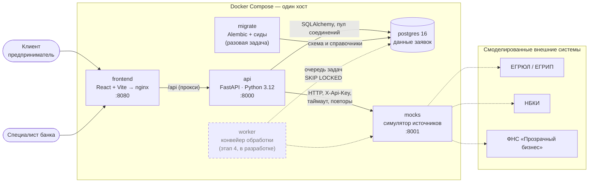
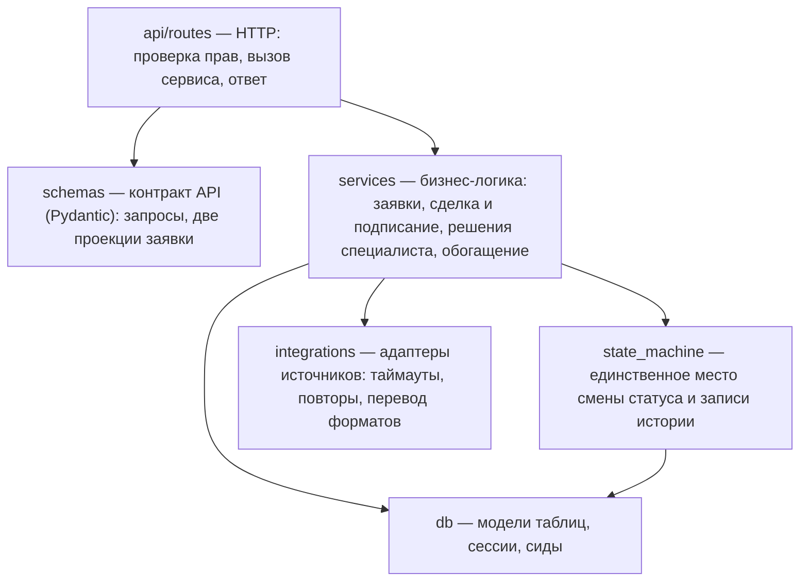
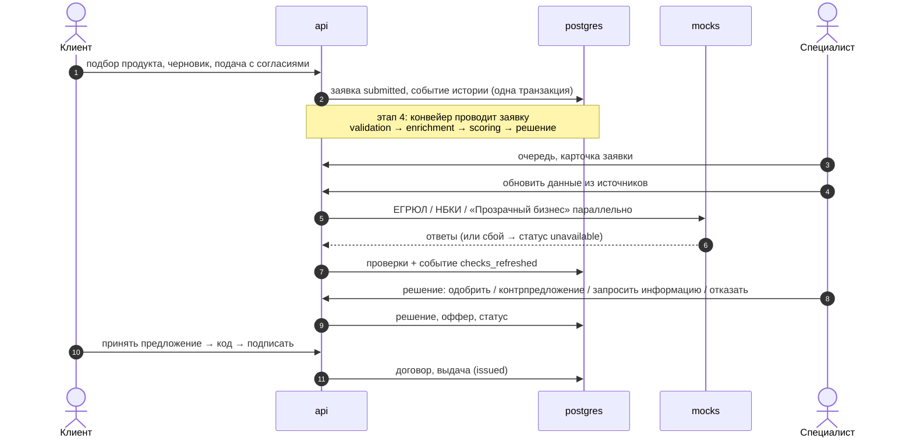

# Архитектура

## Компоненты и связи

Пунктир — то, что запланировано (этап 4) или смоделировано (внешние системы).

| Сервис | Технологии | Назначение |
|---|---|---|
| `frontend` | React 19, Vite, nginx | кабинет клиента и кабинет специалиста; nginx раздаёт сборку и проксирует `/api` |
| `api` | FastAPI, Pydantic v2, SQLAlchemy 2, PyJWT | API кабинета: заявки, сделки, решения специалиста, обогащение данными |
| `migrate` | Alembic | применяет миграции схемы и загружает справочники и демо-данные, затем завершается |
| `postgres` | PostgreSQL 16 | хранение: заявки, история, проверки, оценки, решения, офферы, договоры |
| `mocks` | FastAPI | заменяет ЕГРЮЛ/ЕГРИП, НБКИ и «Прозрачный бизнес»: свои форматы, ключ доступа, задержки, сбои |

## Слои бэкенда

Правило зависимостей: маршруты не работают с базой напрямую, статус заявки меняет только автомат состояний,
форматы внешних систем знают только адаптеры.

## Процесс заявки

## Нефункциональные решения

| Аспект | Как обеспечено |
|---|---|
| Безопасность | JWT с ролями; клиент видит только свои заявки (чужая — 404) и клиентскую проекцию без внутренних оценок банка; код подписи хранится только как SHA-256, сравнение за постоянное время, 3 попытки и 5 минут; база и симулятор доступны только с локального хоста; контейнеры работают не от root; секреты — через переменные окружения |
| Целостность данных | транзакции; оптимистичная блокировка заявки (`version` → `409 concurrent_update`); статусы — только через автомат с таблицей переходов; CHECK-ограничения на перечисления; идемпотентная подача (`Idempotency-Key`) |
| Отказоустойчивость | таймауты и повторы с растущей паузой при обращении к источникам; недоступный источник не ломает обработку (статус `unavailable`); healthcheck сервисов; API работает без симулятора |
| Наблюдаемость | сквозной `X-Request-Id` во всех попытках запроса к источнику — в логах бэкенда и журнале симулятора; история заявки как журнал аудита |
| Сопровождение | миграции Alembic с проверкой расхождения моделей и схемы тестом; OpenAPI, проверяемый тестом на актуальность; единый формат ошибок со справочником кодов; lock-файлы зависимостей |
| Масштабирование | API без состояния (JWT) — можно запускать несколько экземпляров; подготовка базы вынесена в отдельную задачу `migrate`, чтобы экземпляры не применяли миграции одновременно; пул соединений с базой |
