# Модель данных

PostgreSQL 16, схема создаётся миграциями Alembic (`backend/migrations/versions/`), модели — `backend/app/db/models.py`.

```mermaid
erDiagram
    companies ||--o| bank_profiles : "обороты в банке"
    companies ||--o{ accounts : "сотрудники-клиенты"
    companies ||--o{ applications : "подаёт"
    products ||--o{ applications : "по продукту"
    applications ||--o{ application_events : "история"
    applications ||--o{ checks : "проверки по источникам"
    applications ||--o{ scoring_results : "оценки"
    applications ||--o{ decisions : "решения"
    applications ||--o{ info_requests : "запросы информации"
    applications ||--o{ offers : "предложения"
    applications ||--o| contracts : "договор и выдача"
    applications ||--o{ sign_codes : "коды подписи"
    applications ||--o{ idempotency_keys : "повторные запросы"
    accounts ||--o{ idempotency_keys : ""

    companies {
        string inn PK "ИНН"
        string type "legal | ip"
        string status "active | liquidating | liquidated"
        string name
        string ogrn
        string kpp "у ИП нет"
        date registered_at
        string director
        json founders
        string okved_code
        string legal_address
        string account "расчётный счёт"
    }
    bank_profiles {
        string company_inn PK, FK
        bigint monthly_revenue "₽ в месяц"
        numeric revenue_growth "% за 12 мес."
        int history_months
    }
    accounts {
        string id PK "логин тестовой учётки"
        string role "client | analyst"
        string company_inn FK
        string name
    }
    products {
        string id PK
        string name
        bigint min_amount
        bigint max_amount
        int max_term_months
        numeric spread "надбавка к ключевой ставке"
    }
    applications {
        string id PK "A-1027 (последовательность)"
        string company_inn FK
        string product_id FK
        bigint amount
        int term_months
        string purpose
        string collateral
        json contact
        json consents "БКИ, персональные данные"
        string status "13 статусов"
        json company_snapshot "реквизиты на момент подачи"
        timestamptz submitted_at
        int version "оптимистичная блокировка"
    }
    application_events {
        bigint id PK
        string application_id FK
        string kind "status_changed | checks_refreshed"
        string status "статус после события"
        string actor "client | system | analyst"
        string note
        timestamptz created_at
    }
    checks {
        bigint id PK
        string application_id FK "уникально с source"
        string source "bank | egrul | nbki | pb"
        string status "ok | warning | fail | unavailable"
        string summary
        json details "данные источника"
        timestamptz fetched_at
    }
    scoring_results {
        bigint id PK
        string application_id FK
        int score
        int min_score
        json inputs
        json factors
        json rate_breakdown
        json recommendation
        string explanation
        json improvements
    }
    decisions {
        bigint id PK
        string application_id FK
        string outcome
        bigint requested_amount
        bigint approved_amount
        string decided_by "system | analyst"
        string reason_code
        string comment_for_client
        bool followed_system
    }
    info_requests {
        bigint id PK
        string application_id FK
        string comment
        json items
        json answers
        timestamptz responded_at
    }
    offers {
        bigint id PK
        string application_id FK
        string type "approved | counter_offer"
        bigint amount
        int term_months
        numeric rate
        bigint monthly_payment
        json requested "что просил клиент"
        timestamptz valid_until
    }
    contracts {
        bigint id PK
        string application_id FK
        string contract_number "КД-1024/2026"
        bigint amount
        string account
        timestamptz signed_at
        timestamptz issued_at
    }
    sign_codes {
        bigint id PK
        string application_id FK
        string code_hash "только SHA-256"
        int attempts_left
        timestamptz expires_at
    }
    idempotency_keys {
        string key PK
        string account_id FK
        string application_id FK
    }
```

## Соглашения

| Что | Как |
|---|---|
| Деньги | целые рубли, `BIGINT`; ставки — `NUMERIC(5,2)` |
| Время | `timestamptz`, в API — ISO 8601 в UTC |
| Перечисления | строки с CHECK-ограничением (новое значение — простая миграция) |
| JSON-поля | `JSONB`; структура задаётся Pydantic-моделями при чтении и записи |
| Номера заявок | последовательность `application_number_seq`: `A-1000`, `A-1001`, … |
| Удаление | дочерние записи заявки удаляются вместе с ней (`ON DELETE CASCADE`) |
| Параллельные изменения | `applications.version`: при расхождении — `409 concurrent_update` |
| Имена ограничений | единая схема: `pk_`, `fk_`, `uq_`, `ck_`, `ix_` |

Данные синтетические: `data/seed/*.json` — компании, учётки, продукты, демо-заявки; `mocks/data/*.json` — данные внешних источников.
