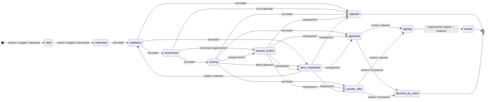

# Диаграмма состояний заявки

Статусы и разрешённые переходы — таблица `TRANSITIONS` в `backend/app/services/state_machine.py`.
Любой переход вне таблицы — ошибка `409 invalid_transition`; каждый переход записывается в историю заявки.

`*` — переходы выполняет конвейер обработки (этап 4, в разработке). Сейчас поданная заявка остаётся в `submitted`;
заявки во всех статусах обработки и решения есть в демо-данных, и с ними работают специалист и клиент.

| Статус | Подпись в интерфейсе | Кто действует |
|---|---|---|
| `draft` | Черновик | клиент заполняет заявку |
| `submitted` | Заявка подана | — |
| `validation` | Проверяем заявку | конвейер (этап 4) |
| `enrichment` | Запрашиваем данные в БКИ и ФНС | конвейер (этап 4); специалист может обновить данные |
| `scoring` | Оцениваем заявку | конвейер (этап 4) |
| `manual_review` | Рассматривает специалист | специалист принимает решение |
| `docs_requested` | Нужна дополнительная информация | клиент отвечает или специалист решает |
| `approved` | Одобрено | клиент принимает или отказывается |
| `counter_offer` | Контрпредложение | клиент принимает или отказывается |
| `signing` | Подписание договора | клиент подписывает кодом |
| `issued` | Кредит выдан | конечный |
| `rejected` | Отказ | конечный |
| `declined_by_client` | Клиент отказался | конечный |

Кроме смены статуса история заявки содержит события без смены статуса (`kind = checks_refreshed` — данные
из источников запрошены повторно). Они пишутся функцией `record_event()` и таблицу переходов не обходят.

Полноту графа проверяют тесты `backend/tests/test_state_machine.py`: каждый статус достижим из черновика,
из каждого незавершённого статуса есть путь к конечному, история каждой демо-заявки — допустимый путь.
